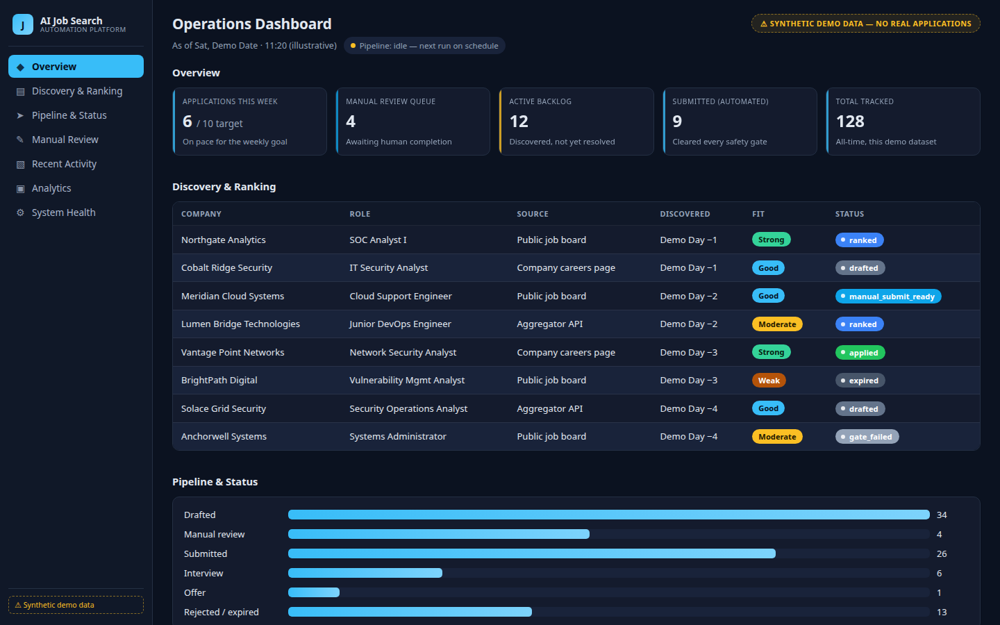
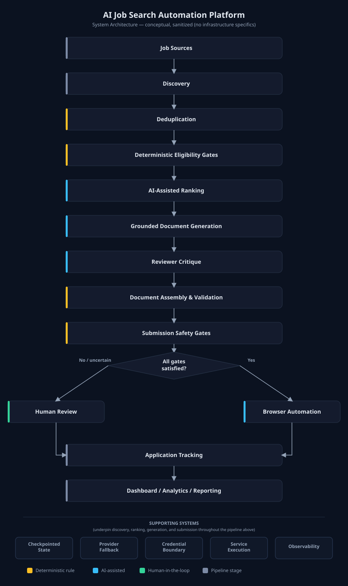

<div align="center">

# AI Job Search Automation Platform
### Workflow Engineering · Security Gates · Operational Evidence


[Architecture](docs/architecture.md) · [License](LICENSE)

</div>

[What this is](#what-this-is) · [The dashboard](#the-dashboard) · [Key capabilities](#key-capabilities) · [Architecture](#architecture) · [Engineering highlights](#engineering-highlights) · [Security & responsible AI](#security--responsible-ai)

---

**Engineering a reliable, security-conscious AI workflow for real-world job-search automation**

*A portfolio engineering project by **Scott Renny**.*

> Documentation-only showcase — not the production source repository, and not the upstream project it started from. No production code, production data, or upstream source code appears here. See [Provenance](#provenance).

## What this is

A production automation system that discovers job postings, filters them against explicit eligibility rules, ranks fit with an LLM, and drafts tailored application documents from my own verified background — then, only once a chain of deterministic safety gates clears, submits the application automatically. The moment anything is uncertain (a CAPTCHA, a security question, an incomplete field), it deliberately stops and hands control back to me instead of guessing. It runs unattended, on a fixed schedule, as systemd-managed services on Linux, with a dedicated service identity, encrypted credential storage, and a live operational dashboard. I built it because manually sourcing, tailoring, and tracking applications well doesn't scale — and I wanted to bring real production-engineering discipline (checkpointing, fallback, least privilege, test coverage) to my own job search rather than write a fragile one-off script.

## The dashboard

<p align="center">
  
</p>

<p align="center"><em>⚠ Every company, role, date, and figure shown is fabricated demo data — see <a href="demo/README.md">demo/README.md</a> for the dataset, or open the <a href="demo/dashboard-demo.html">live interactive demo</a> yourself. No real employer or application information appears anywhere in this repository.</em></p>

## Key capabilities

**Discovery & filtering** — multi-source job discovery · persistent cross-run deduplication · deterministic eligibility gates (seniority, employment type, commute, occupation relevance) applied before any AI call is made

**AI-assisted evaluation & generation** — LLM-based fit ranking · Grounded Application Document Generation from verified candidate data · independent automated reviewer critique · mechanical document assembly, PDF layout validation, and ATS text-layer verification

**Submission & human control** — layered submission safety gates (CAPTCHA/MFA/account-creation detection, completeness checks, per-platform rate limits, live-posting checks) · isolated, disposable browser automation · automatic hand-off to human review the moment any gate is uncertain

**Reliability, security & observability** — checkpointed, resumable multi-stage orchestration · dual-provider AI fallback with quota/rate-limit handling · atomic, cross-identity-safe state management · least-privilege, service-managed execution · encrypted credential storage · a live operational dashboard and analytics · an automated test suite covering operational and security-relevant behavior, not just features

## Architecture

<p align="center">
  
</p>

Postings flow through eleven stages — discovery → deduplication → deterministic eligibility gates → AI-assisted ranking → grounded document generation → reviewer critique → document assembly & validation → submission safety gates → **browser automation or human review** → application tracking → dashboard/analytics/reporting — underpinned by checkpointing, AI-provider fallback, a credential-security boundary, systemd service execution, and observability throughout. Full explanation in [`docs/architecture.md`](docs/architecture.md); the diagram's Mermaid source and design rationale are in [`docs/architecture-diagram.md`](docs/architecture-diagram.md).

**What I designed and built:** this project started from an open-source, manually-driven job-application framework that handled CV/cover-letter drafting through interactive assistant commands. On top of that foundation, I designed and built the production automation layer described above and shown in the diagram — the unattended multi-stage pipeline, the deterministic eligibility and safety gates, the AI-provider fallback and quota-handling logic, the browser-automation layer, the credential-security architecture, the atomic state-management layer, the systemd deployment, and the operational dashboard. None of it has an equivalent in the original project. See [Provenance](#provenance) and the full [portfolio case study](docs/portfolio-case-study.md).

## Engineering highlights

A few of the harder problems, each real, sanitized, and told problem → diagnosis → solution → lesson in [`docs/engineering-stories.md`](docs/engineering-stories.md):

- **Interactive-session quota and process fragility** — early automation shared one interactive session's usage quota and process lifecycle; both failed for real, mid-run, more than once. Fixed by moving every stage to standalone, checkpointed processes with their own AI-provider fallback and OS-service-managed execution.
- **A security review catching an overly broad privilege design — before it shipped.** A first design for a privileged credential-encryption operation would have granted the automation's service account a general-purpose capability well beyond what it needed. Caught on review, replaced with a minimal, single-purpose, argument-free root helper.
- **A CAPTCHA a text-only scan couldn't see.** A hidden CAPTCHA widget rendered no matching visible text at all, so the original text-keyword safety scan missed it. Fixed with a second, independent DOM-level detection pass.

Five more — a killed background process, a cross-identity permission-reset bug, a browser-extension hijack, a platform-wide rate limit no per-job record could represent, and a runaway retry loop — are in the full write-up.

## Security & responsible AI

**Grounded Application Document Generation.** My real experience, education, certifications, and skills are the fixed input; AI assists only with tailoring how that real material is presented to a specific posting. Generation is explicitly constrained to verified candidate information and passes through an independent automated reviewer critique before anything is finalized — a disciplined process-and-review safeguard, not a claim that fabrication is impossible, and not a deterministic fact-checker. Full explanation and honest limitations in [`docs/grounded-generation.md`](docs/grounded-generation.md).

**Human Authority at Consequential Boundaries.** The system can carry an eligible application all the way to automated submission when every deterministic gate clears — but a CAPTCHA, an MFA prompt, an account-creation step, a security question, an ambiguous free-text question, or incomplete required information all deliberately stop automated progress and hand the fully-prepared item to me instead. This is a design principle, not a gap: the system is not, and is not presented as, fully autonomous.

**Underlying security design:** least privilege end to end (a dedicated, unprivileged service account; a narrow, single-purpose privileged helper for the one operation that genuinely needs it, in place of a broad grant); fail-closed behavior everywhere an external dependency can be unavailable; encrypted, never-plaintext credential storage; isolated, disposable browser sessions. Full detail in [`docs/security.md`](docs/security.md).

## Technology stack

Only technologies actually used and verified in this project:

- **Core & orchestration:** Python, Linux
- **Service execution:** systemd (services, timers, `systemd-creds` for credential sealing)
- **AI / LLM:** Claude via Claude Code (primary), Groq (secondary/fallback provider)
- **Browser automation:** Playwright / Chromium, isolated disposable sessions
- **Document generation:** LaTeX, compiled and validated to PDF
- **Dashboard:** hand-built HTML/CSS, no framework
- **Quality & CI:** Python `unittest`, Git, GitHub Actions

## Testing & operational evidence

The automated test suite currently stands at **2,286 passing tests**, **8 skipped** (environment-dependent), **143 passing parameterized subtests**, and **2 failing tests that are themselves environment-dependent rather than logic defects** — not 100% passing, reported with the exact denominator and the reason for both failures in [`docs/testing.md`](docs/testing.md). Coverage specifically includes gate logic, credential-store and service-identity behavior, and cross-identity state-management edge cases that caused real production incidents — not just feature happy-paths. Reliability mechanics (checkpointing, atomic state, provider fallback, bounded retries, recovery) are detailed in [`docs/reliability.md`](docs/reliability.md).

## Deployment

Two systemd-managed services — a scheduled pipeline unit and a dashboard service — run under a dedicated, unprivileged service account. The application has no dependency on any specific host; it's currently deployed on a home-lab Linux server I call **Atlas**, part of my broader personal Cyber Operations Center environment:

```
Cyber Operations Center
        └── Atlas (Linux server)
                └── AI Job Search Automation Platform (this project)
```

## Documentation

| Doc | Covers |
|---|---|
| [`docs/architecture.md`](docs/architecture.md) | Pipeline stages, components, data flow, deployment model |
| [`docs/architecture-diagram.md`](docs/architecture-diagram.md) | Mermaid source + design rationale for the diagram above |
| [`docs/security.md`](docs/security.md) | Least privilege, credential handling, fail-closed design, human-authority boundaries |
| [`docs/reliability.md`](docs/reliability.md) | Checkpointing, atomic state, provider fallback, rate limiting, recovery |
| [`docs/testing.md`](docs/testing.md) | Testing philosophy and current, accurately-reported test statistics |
| [`docs/grounded-generation.md`](docs/grounded-generation.md) | How AI-assisted document generation stays truthful, and its real limits |
| [`docs/engineering-stories.md`](docs/engineering-stories.md) | Eight sanitized real-incident deep dives |
| [`docs/portfolio-case-study.md`](docs/portfolio-case-study.md) | Long-form case study: problem, evolution, architecture, decisions, lessons |
| [`demo/README.md`](demo/README.md) | Synthetic-data dashboard demo, dataset notes, and screenshots (no real data) |

## Provenance

Starting from an open-source job-application framework as a foundation, I designed and built the production automation and security-engineering layer that transformed it into the system described here. This showcase contains no production source code, no production data, and no upstream source code. Full context in the [portfolio case study](docs/portfolio-case-study.md).

## License

Copyright © 2026 Scott Renny. All rights reserved.

This applies to the original showcase documentation, diagrams, and other original material in this repository. It does not apply to, and does not imply any ownership over, the upstream open-source framework referenced under [Provenance](#provenance) — this repository contains no upstream source code. No open-source license has been selected for this repository at this time; if original source code is published here later, its licensing will be decided separately.
