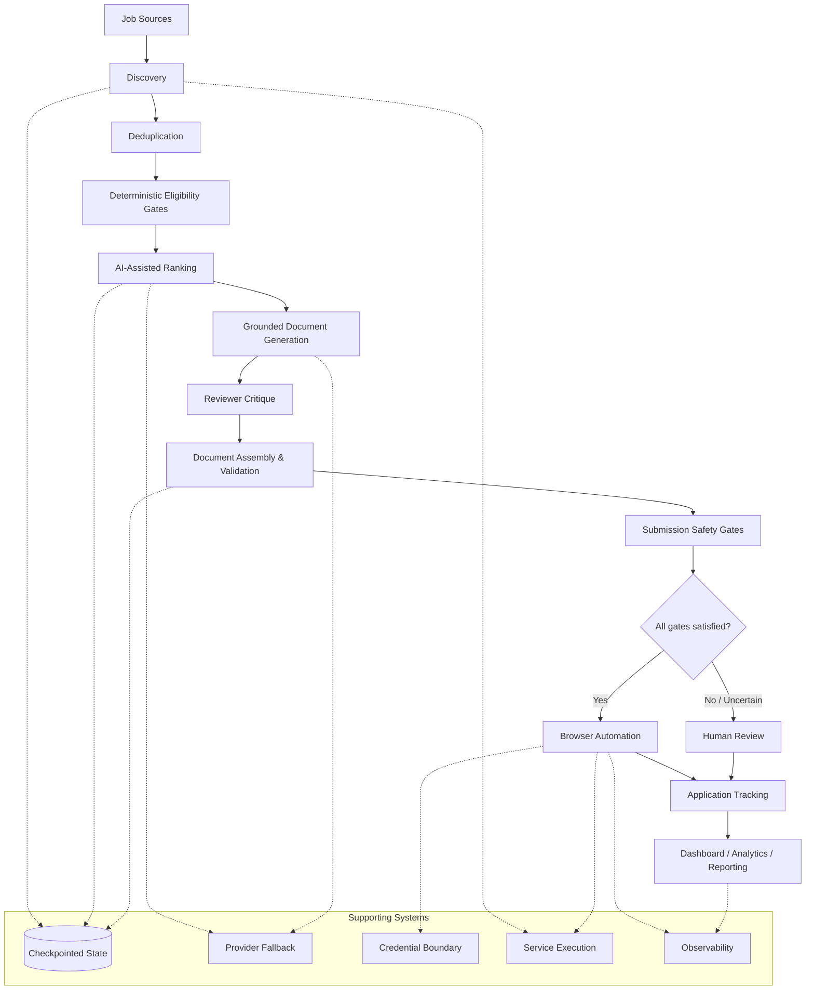

# Architecture Diagram

## Mermaid version (current, sanitized)

### Reading notes

- The vertical spine is the real pipeline order: discovery → dedup → deterministic gates → AI ranking → grounded generation → reviewer critique → assembly/validation → submission gates → automation-or-human → tracking → reporting.
- The single decision diamond (`All gates satisfied?`) is the **Human Authority at Consequential Boundaries** principle made visible: it is the only branch point in the whole diagram, and it exists specifically so an uncertain case never proceeds to automated submission.
- The "Supporting Systems" subgraph is intentionally not wired into every node — the dotted lines show which pipeline stages actually depend on which supporting system, so the diagram stays a *concept map*, not a source-code dependency graph.

## Specification for a polished graphical version (later phase)

This Mermaid diagram is the accurate content source for a future designed graphic. When that's produced, it should:

- Keep the same eleven-stage vertical spine and the single decision point — don't add stages or branches that aren't in this file.
- Visually distinguish three categories of node: **deterministic/rule-based** stages (dedup, eligibility gates, safety gates), **AI-assisted** stages (ranking, generation, reviewer critique), and **human-in-the-loop** stages (human review branch) — color or icon coding, not more boxes.
- Treat the "Supporting Systems" band as a distinct visual layer (e.g., a horizontal strip beneath the spine), not additional boxes crowding the main flow.
- Match the visual language already used across my dashboard/COC-adjacent materials (dark-mode-first, restrained palette, no gradient/glow "AI startup" styling) — this is an engineering/security case study, not a product landing page.
- Avoid representing any actual file names, service names, ports, or hostnames on the graphic itself — the diagram communicates the pipeline concept, not a systems-inventory map.

No graphic has been generated yet; this section is the brief for producing one in a later phase.
