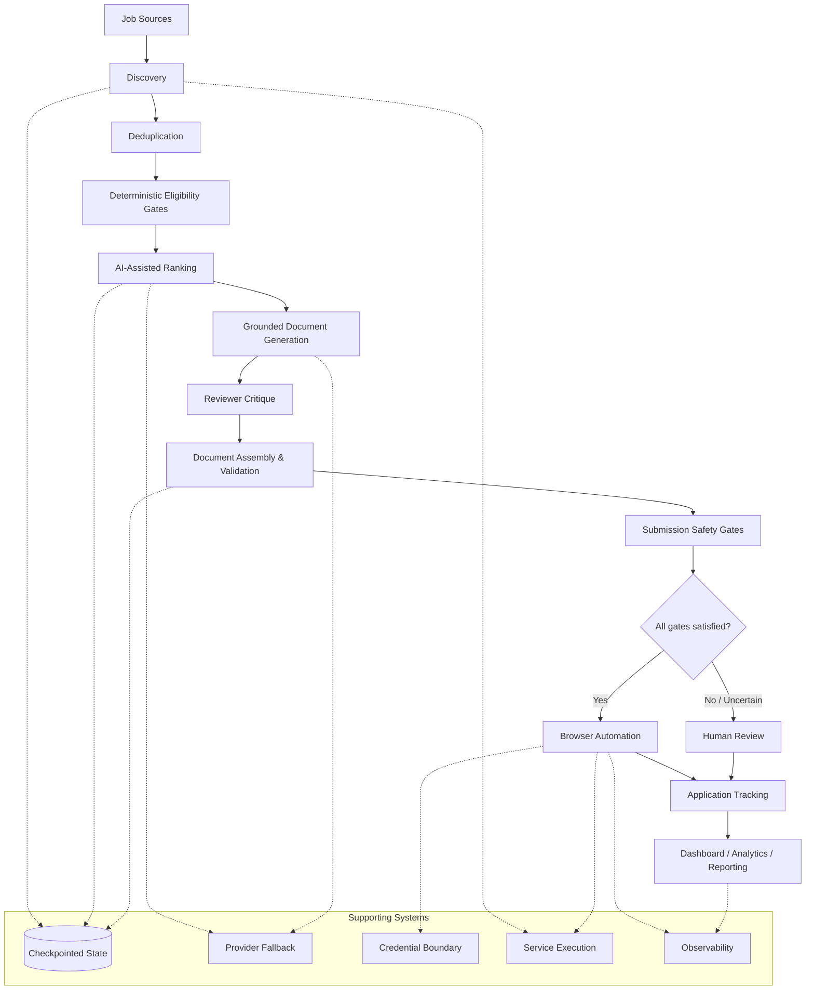

# Architecture Diagram

## Mermaid version (current, sanitized)

### Reading notes

- The vertical spine is the real pipeline order: discovery → dedup → deterministic gates → AI ranking → grounded generation → reviewer critique → assembly/validation → submission gates → automation-or-human → tracking → reporting.
- The single decision diamond (`All gates satisfied?`) is the **Human Authority at Consequential Boundaries** principle made visible: it is the only branch point in the whole diagram, and it exists specifically so an uncertain case never proceeds to automated submission.
- The "Supporting Systems" subgraph is intentionally not wired into every node — the dotted lines show which pipeline stages actually depend on which supporting system, so the diagram stays a *concept map*, not a source-code dependency graph.

## Polished graphical version

A hand-built SVG realizing the brief below now exists at [`architecture-visual.svg`](architecture-visual.svg) (rendered preview: [`../demo/screenshots/architecture-visual-preview.png`](../demo/screenshots/architecture-visual-preview.png)). It follows this specification exactly:

- Keeps the same eleven-stage vertical spine and the single decision point — no added stages or branches beyond what's in the Mermaid version above.
- Visually distinguishes three categories of node by accent color: **deterministic/rule-based** stages (dedup, eligibility gates, assembly/validation, safety gates — amber), **AI-assisted** stages (ranking, generation, reviewer critique, browser automation — cyan), and **human-in-the-loop** (human review — green), plus a neutral tone for plain pipeline/infrastructure stages, with a legend.
- Treats "Supporting Systems" as a distinct horizontal band beneath the spine, labeled with a one-line caption rather than wired connector lines to individual stages — the earlier draft tried literal per-stage connectors and it made the diagram read as a dependency graph rather than a concept map, so that approach was dropped in favor of the plain caption used in the Mermaid reading notes above.
- Uses a dark background with a restrained, desaturated palette — no gradients, no glow, no "AI startup" styling.
- Contains no file names, service names, ports, hostnames, or other infrastructure specifics — only the pipeline concept.

The Mermaid version above remains the source of truth for the diagram's *content* (which stages exist, in what order, with what dependencies); the SVG is the polished presentation layer built from it.
